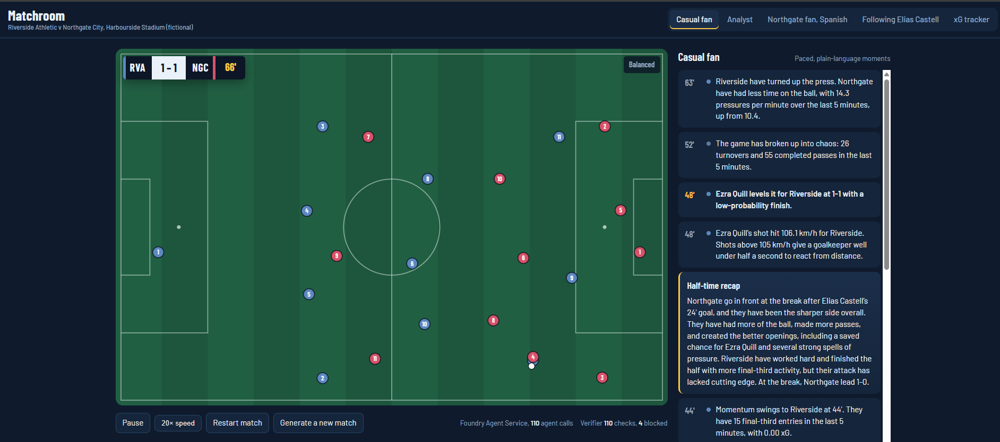
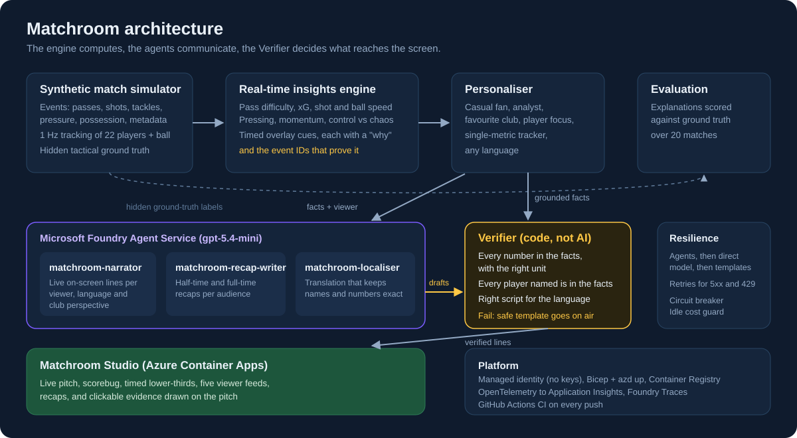
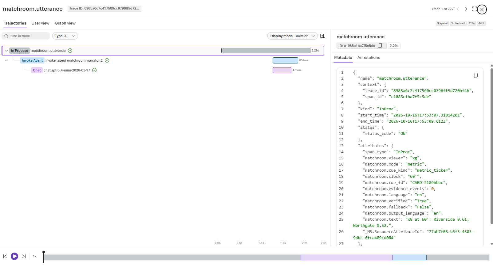
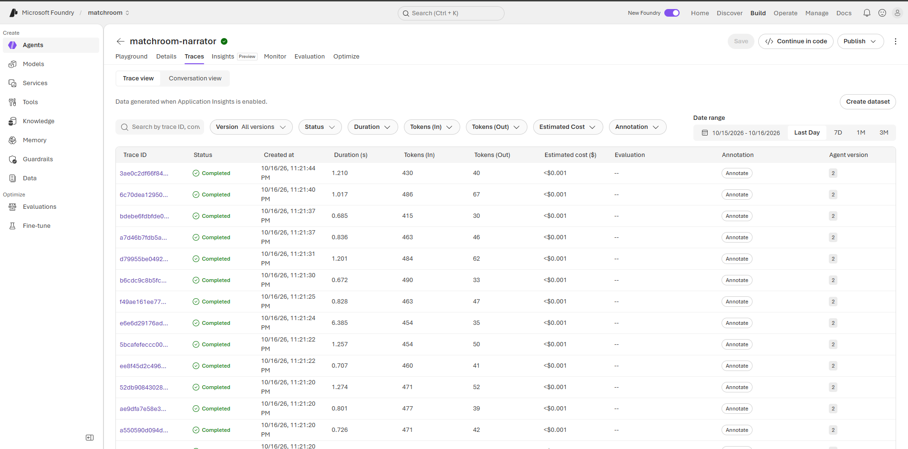

# Matchroom ⚽ Explainable Multi-Agent Match Insights Engine

> Entry for **Inside the Game: Developer Hackathon**, challenge *The Synthetic Match Insights Engine for Premier League Studio*.

Matchroom turns a live stream of **synthetic, football-realistic match events** into studio-ready insight:
timed overlay cues, live narratives and recaps, personalised for every fan, where **every claim links back to the events that prove it**.

> All clubs, players, venues and matches are fictional and generated by our own simulator. No real Premier League data is used.

**▶ Live demo:** https://ca-matchroom-oy5o46jqadfro.bluebush-9765fe66.eastus2.azurecontainerapps.io/
(the match starts when you open it and pauses 30 s after the last viewer leaves)



### Measured on the live deployment

| | |
|---|---|
| AI path | 3 versioned **Foundry Agent Service** agents on `gpt-5.4-mini` |
| Agent run time inside Foundry | about 0.7 to 1.3 s per line (Foundry Traces) |
| Cost per on-screen line | under $0.001 (Foundry Traces estimate) |
| Verifier | every AI line checked before air; blocked lines are listed in the studio (*N blocked*) with the reason |
| Explanations vs hidden ground truth | pressing-surge cues correct 53% of the time vs about 20% by chance (20 matches) |
| Resilience | agents, then direct model, then templates; retries on 5xx and 429; circuit breaker |



## The five-stage pipeline

| Stage | Challenge requirement | Matchroom component | Status |
|---|---|---|---|
| **a. Ingest** | Synthetic events as they happen | `simulator/` + `engine/replay.py` time-merged event + 1 Hz tracking stream | ✅ |
| **b. Interpret** | Stats, patterns, context | `engine/insights.py`: possession, pass quality, xG, pressing, momentum, distance, speed | ✅ |
| **c. Explain** | Why a moment matters | Every cue carries `explain.why` + `evidence_event_ids` + metrics | ✅ |
| **d. Render** | On-screen, timed, machine-readable | Overlay cue JSON (`t_in`/`t_out`, priority, kind) + Matchroom Studio | ✅ |
| **e. Personalise** | Analyst vs casual fan, club, player focus, language | `agents/`: Personaliser + Verifier (code) and three Foundry Agent Service agents | ✅ |

## What the engine detects

| Feature from the brief | How |
|---|---|
| Player identification + speed/distance on threshold | `player_tag` cues at a 27 km/h sprint threshold (match-record speeds) and the 10 km covered mark |
| Pass quality: distance, accuracy, difficulty | Per-pass difficulty (distance, pressure, progression, lane clearance, receiver pressure) → 1–10 rating; `key_pass` cues for line-breaking passes |
| Ball and shot speed | Pass ball speed and shot speed (km/h) on every event; `speed` cues above 105 km/h |
| Key moments | `goal` (with build-up chain, assist, run of play), `big_chance` (xG ≥ 0.20) |
| Control vs chaos | `game_state` cues from the rolling turnover ratio |
| Tactical pressure changes | `pressure_surge`: pressing per minute of opponent possession vs match baseline |
| Game rhythm / momentum | `momentum_swing` from rolling xG, final-third entries, pressing and completed passes |
| Milestones | `milestone` (pass volume), distance landmarks |

### Example cue (machine-readable overlay)

```json
{
  "kind": "pressure_surge", "t_in": 3824.1, "t_out": 3836.1, "clock": "63'", "priority": 2,
  "team": "RVA", "headline": "RVA have turned up the press",
  "data": {"pressures_last_5": 29, "pressures_per_opp_min": 14.3, "match_avg_per_opp_min": 10.4},
  "explain": {
    "why": "RVA are pressing 14.3 times per minute of NGC possession over the last 5 minutes, up from a match average of 10.4. NGC have less time on the ball.",
    "evidence_event_ids": ["SYN-0007-02402", "SYN-0007-02404", "..."]
  }
}
```

## Data innovation: a labelled synthetic dataset

`simulator/sim.py` generates a full 90+ minute match from a seed:

- `events.jsonl`: kickoff, pass, carry, shot, save, goal, tackle, pressure, possession change, match metadata, half/full time
- `tracking.jsonl`: 1 Hz x/y and speed for the ball and all 22 players
- `truth.json`: **hidden ground-truth tactical phases** (high press, low block, direct, patient) per team

Calibrated to realistic ranges: ~80–83% pass completion, 15–25 shots, 1.5–3 total xG, ~10.5 km per outfield player, top speeds ~35 km/h.

Because the simulator knows the true tactics, **we can measure whether the explanations are right**:

```
python -m scripts.evaluate
20 matches: precision 50/95 = 53%, recall 26/45 = 58%
```

High-press phases cover about 20% of match time, so a random detector would score roughly 20% precision. Our pressure-surge explanations are right about 2.5× more often than chance. We publish the evaluation so the number can be improved, not just claimed.

## The agent team

```
engine cue ──► Personaliser ──► Narrator ──► Verifier ──► Localiser ──► Verifier ──► on-screen feed
                (what this         (how it's     (no new numbers,   (any language,    (names/numbers
                 viewer sees)       said)         units or players)  names kept)       survived?)
half / full time ──► RecapWriter ──► Verifier ──► Localiser ──► recap
```

| Agent | Role |
|---|---|
| **Personaliser** | Filters and paces cues per viewer; adds periodic player cards and metric tickers |
| **Narrator** | Rewrites a grounded cue for the viewer's mode and club allegiance (Foundry model, or templates offline) |
| **Verifier** | Deterministic guardrail: every number must exist in the facts **with the right unit**, every named player must be in the facts, and the text must be in the target language's script (added after a live test produced a stray Hindi word inside Spanish commentary). Live testing also exposed an over-strict rule that rejected an exact value (0.281 xG) the model had quoted correctly; it is fixed and covered by a test. Failures are replaced by a safe template, so a hallucination never reaches air |
| **RecapWriter** | Half-time and full-time recaps, casual or analytical |
| **Localiser** | The `matchroom-localiser` Foundry agent (Azure AI Translator is supported if a key is configured), then re-verified so names and numbers survive translation |

### Viewer modes (same match, different experiences)

| Mode | Example |
|---|---|
| `casual` | *"GOAL! Elias Castell scores for Northgate!"* (paced, jargon-free, about 16 items per match) |
| `analyst` | *"Momentum swings to NGC. In the last 5 minutes NGC have 8 final-third entries and 0.28 xG vs 3 and 0.01 for RVA."* (about 86 items) |
| `player_focus` | *"Elias Castell, 30': 44 passes (84.1%), 2 shots, 0.32 xG, 2 tackles won, 3.64 km, top speed 32.0 km/h."* |
| `metric` | *"xG at 30': Riverside 0.29, Northgate 0.43."* (one number the viewer cares about) |
| favourite club | *"Get in! GOAL! …"* vs *"Oh no. GOAL! …"* |
| language | any BCP-47 code, e.g. `--lang es` |

```bash
python -m agents.run data/match_001                                         # 3 preset viewers
python -m agents.run data/match_001 --mode player_focus --player "Elias Castell"
python -m agents.run data/match_001 --mode metric --metric xg --club NGC
python -m agents.run data/match_001 --backend agents --lang es     # Foundry agents (see .env.example)
```

Feeds land in `data/<match>/feeds/<viewer>.jsonl`. Each item has timing, text, language, a `verified` flag, and evidence event IDs.

## Running on Microsoft Foundry Agent Service

The three AI roles are **versioned Foundry agents** (Build > Agents in the Foundry portal):

| Foundry agent | Role |
|---|---|
| `matchroom-narrator` | Live on-screen lines for one viewer: mode, language, club perspective |
| `matchroom-recap-writer` | Half-time and full-time recaps |
| `matchroom-localiser` | Translation that keeps names and numbers exact |

```bash
python -m agents.foundry                    # create/update the agents and test each one
python -m ui.server --backend agents        # run the studio on the agents
```

A new agent version is created only when its instructions or model change (a hash is stored in the agent's
metadata), so the deployed app safely registers them at start-up. If the Agent Service can't be reached, the app
falls back to calling the model directly, and if that fails too, to the Verifier-safe templates. The broadcast never stops.

**Tracing.** Every on-screen line is one trace in Application Insights: a `matchroom.utterance` span (viewer, cue,
evidence count, **Verifier result and any issues**, final text) containing the `invoke_agent matchroom-narrator` span
(OpenTelemetry GenAI attributes: agent name and version, model, token usage, latency). Connect the Application Insights
resource to the Foundry project (Agents > Traces > Connect) to browse them in Foundry.

### What a trace looks like

Each on-screen line is one trace: our `matchroom.utterance` span (viewer, cue, Verifier result, final text) wrapping
the Foundry agent run and the model call.




## Matchroom Studio (live web UI)

```bash
python -m ui.server                       # http://localhost:8000, offline templates
python -m ui.server --backend foundry     # live Microsoft Foundry model
```

- **Live pitch** from the 1 Hz tracking stream, with a broadcast scorebug and game-phase chip
- **Lower-third overlays** timed from the cue feed, as they would sit on a live match feed
- **Viewer switcher**: casual fan, analyst, away-club fan in Spanish, player focus, xG tracker. One match, five experiences
- **Clickable evidence**: select any insight to see *why it matters*, whether it passed the Verifier, and the actual passes, shots and pressures behind it drawn on the pitch
- **Fault injection** (`python -m ui.server --backend agents --inject-faults`): corrupts 1 in 5 real AI lines on purpose (an invented number, a player not in the moment, or the wrong script), clearly labelled on screen, to show the Verifier catching every one. Off by default, never on in the deployed demo
- **What the Verifier stopped**: click *N blocked* in the status line to see every AI line that broke a rule: what it wrote, why it was blocked, and what aired instead
- Momentum ribbon, live match stats, half-time and full-time recaps, replay speed, and a button to generate a fresh synthetic match

Standard library only; no build step.

## Deploy to Azure (one command)

```bash
azd auth login
azd env new matchroom
azd env set AZURE_RESOURCE_GROUP rg-matchroom        # resource group that holds your Foundry resource
azd env set AI_RESOURCE_NAME matchroom-resource      # the Foundry / Azure OpenAI resource name
azd up
```

`infra/main.bicep` creates Azure Container Apps, Container Registry (remote build, no local Docker needed),
a user-assigned **managed identity** with *Cognitive Services OpenAI User* on the Foundry resource (no API
keys in the cloud), Log Analytics and Application Insights. The public URL is printed at the end.

## Quick start

The core pipeline needs only Python 3.10+. For the Foundry backend, run `pip install -r requirements.txt` and copy `.env.example` to `.env`.

```bash
python -m simulator.sim --seed 7 --out data/match_001     # generate a match
python -m engine.replay data/match_001                    # run it through the engine, print cues
python -m engine.replay data/match_001 --speed 30         # "live" at 30x real time
python -m unittest -v                                     # tests: evidence grounding + hallucination blocking
python -m scripts.evaluate                                # explainability vs ground truth
```

Outputs: `cues.jsonl` (overlay feed), `stats.json` (team + player stats), `timeline.json` (per-minute momentum, possession, xG).


## Roadmap to submission (Oct 27)

- [x] Synthetic simulator with tracking and ground truth
- [x] Real-time insights engine with explainable, evidence-linked cues
- [x] Tests and ground-truth evaluation
- [x] Agent team: Personaliser, Narrator, Verifier, RecapWriter, Localiser (offline mode + Foundry backend)
- [x] Live Foundry run and prompt tuning
- [x] Live web UI: pitch, overlays, five viewer modes, clickable evidence
- [x] Azure deployment: Bicep + `azd up`, Container Apps, managed identity, App Insights
- [x] Foundry Agent Service agents (versioned) + OpenTelemetry tracing to Application Insights
- [ ] Demo video

## Built with

Python · Microsoft Foundry Agent Service · gpt-5.4-mini (Azure OpenAI in Foundry) · Azure Container Apps · Azure Container Registry · Managed identity · Application Insights + OpenTelemetry · Bicep / Azure Developer CLI · GitHub Actions

## How this was built

Designed, configured, deployed and tested by Sai Shankar Yalla, with AI coding assistance for parts of the implementation.

## License

MIT
